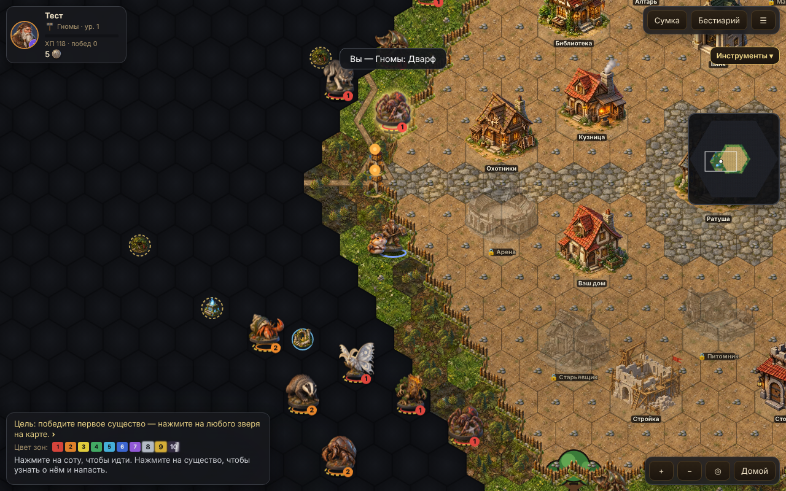
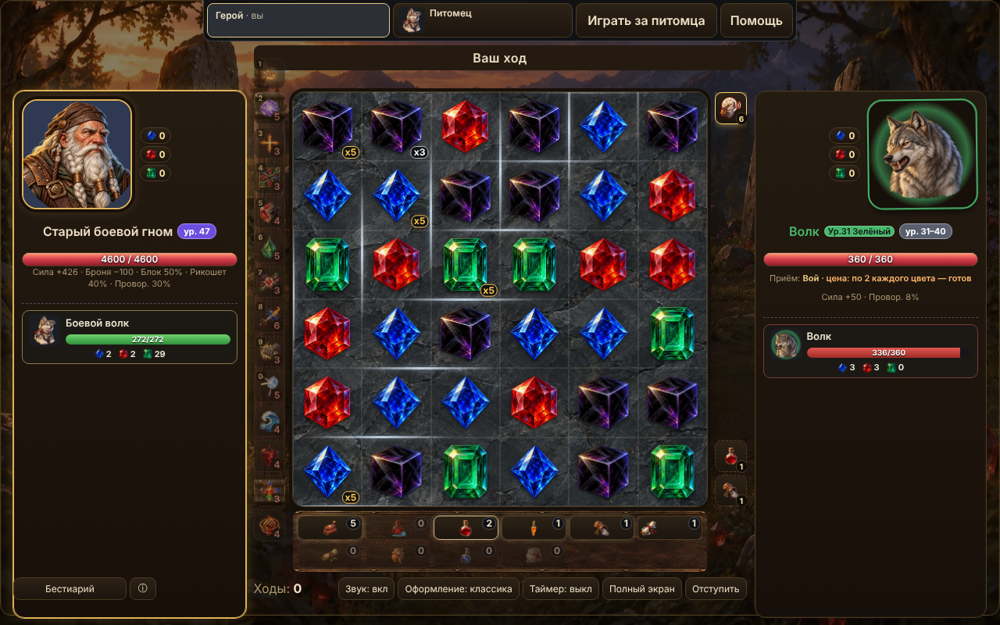
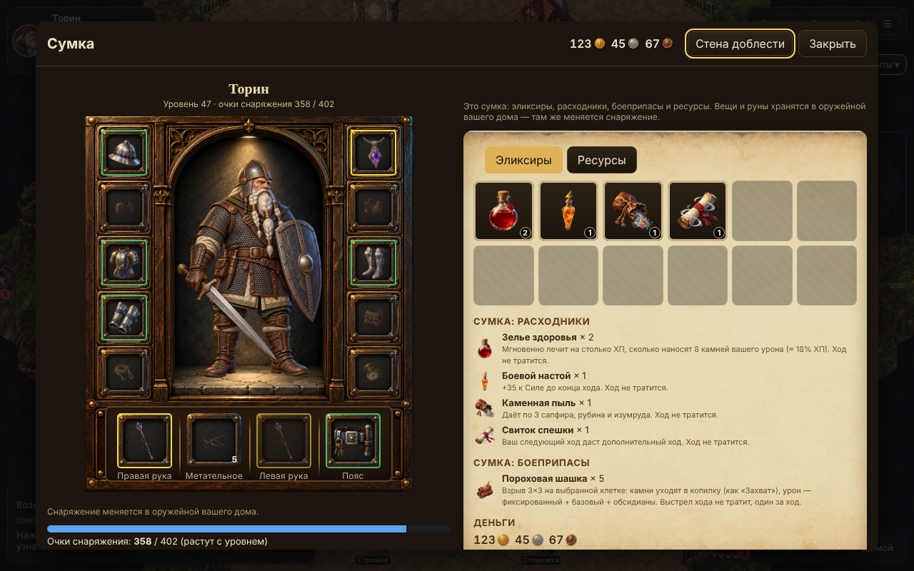
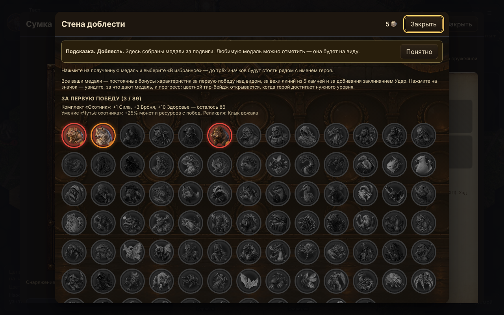
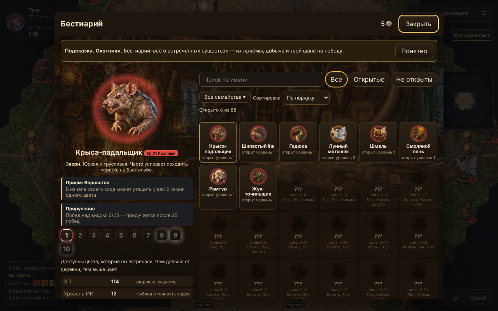
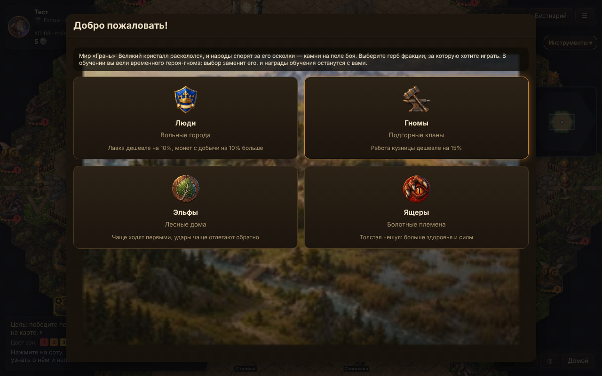

# World in Pieces («Хрупкий мир»)

**Версия 2.2.9.** Фэнтези-RPG в жанре «три в ряд» для браузера (телефон и компьютер), на русском и английском.
Поле 6×6: сапфиры, рубины, изумруды и чёрные кубы обсидиана. Игра начинается на большой карте из шестиугольников:
деревня в центре, вокруг — существа из бестиария, море, остров, замок и подземелье. Нападаете на существо — начинается бой
«три в ряд» против противника, который ходит сам. При первом запуске вы выбираете фракцию: Люди, Гномы, Эльфы или Ящеры.

Игра работает целиком в браузере и без сервера. Необязательный сервер (`server/`) добавляет сохранение в облаке, бои с живыми
игроками, турниры, рейтинг и площадку народа.











## Что есть в игре

- **Карта и мир:** большая карта радиуса 30 с туманом войны, дорогами, озёрами и морем; логова, редкие звери, ночные гости,
  осады деревни, события недели; компас со стрелками «домой» и «к метке». День и ночь и погода включаются в настройках.
- **Деревня:** Ратуша, Лавка, Кузница, Охотничий дом, Ваш дом (оружейная и украшения), Таверна, Мельница, Хижина старьёвщика,
  Библиотека, Банк, Почта, Сторожка стражи, Ювелир, Алхимик, Питомник, Маяк и другие здания; открываются по мере побед.
- **Герой:** 100 уровней (десять цветов по десять), восемнадцать наборов снаряжения, руны в гнёздах, пояс, эликсиры
  (варятся у Алхимика, пьются в бою), боеприпасы (варятся в Кузнице), самоцветы стражей, таланты, заклинания и приёмы фракций,
  медали, значки и титулы, визитка героя.
- **Питомцы:** с 5-го уровня герой водит питомца. В бою герой и питомец играют на двух полях сразу, помогают друг другу
  здоровьем и камнями; питомец учится, получает черты, таланты, снаряжение и амулеты; есть дневник питомца.
- **Существа:** 89 видов в пятнадцати семействах. У каждого свои приёмы, и они стоят камней: существо собирает камни
  и тратит их так же, как герой. Существа растут: после победы над героем набирают силу, пока их не убьют.
- **Места:** Замок (Владыка замка и духи в доспехах игроков), Затерянный остров, Подземелье (бесконечные уровни, каменные
  стражи, скорпионы с самоцветами), мини-игры Маяка, шахматы с бобром-хранителем.
- **Арена:** бои с «тенями» игроков, забег, испытание дня, головоломка дня, сезоны.
- **Бой:** поле 6×6, три вида камней для магии и обсидиан для урона. Экран боя на телефоне и компьютере, два оформления
  (классика и «золото»), журнал боя.
- **База знаний:** встроенная энциклопедия с иллюстрациями и ссылками между статьями: существа, питомцы, вещи, здания, зоны,
  народы, ранги, заклинания. Здесь описаны все правила и числа, поэтому в README они не повторяются.
- **Языки:** русский и английский; язык подбирается по браузеру.
- **Онлайн (нужен сервер):** живые бои, турниры с сеткой, рейтинг, Битва народов, ранги за победы над живыми игроками,
  площадка народа, облачное сохранение. Игра работает и без сервера.

## Фракции



| Фракция | Герой | Родной камень | Приём в бою |
|---|---|---|---|
| **Люди** (Вольные города) | Странствующий рыцарь / рыцарь-женщина | сапфир | *Знамя* — усиливает урон на несколько ходов |
| **Гномы** (Подгорные кланы) | Боевой гном / Боевая гномка | обсидиан | *Рунный молот* — несколько случайных камней становятся обсидианом |
| **Эльфы** (Лесные дома) | Лесная лучница / лучник | изумруд | *Дикий рост* — выбранный камень и соседние прорастают изумрудами |
| **Ящеры** (Болотные племена) | Ящер-следопыт / следопытка | рубин | *Ядовитый укус* — противник теряет здоровье несколько ходов подряд |

У каждой фракции есть мужской и женский герой (выбираются при регистрации), свои врождённые бонусы и свой набор вещей
(«Корона», «Руна», «Роща», «Чешуя»). Приём заряжается родными камнями и ход не тратит. Фракцию можно сменить в Ратуше.

## Основные правила

- Меняйте местами соседние камни, чтобы собрать линию из трёх и более одинаковых. Линия из четырёх и более камней даёт
  дополнительный ход, а длинные линии усиливают сбор.
- **Обсидиан** наносит урон. Сапфиры, рубины и изумруды копятся для заклинаний, приёмов и эликсиров.
- **Сила** — единственный множитель урона. Из каждого удара вычитается число Брони (урон не меньше 20% удара), есть Блок,
  Рикошет и Ярость.
- **Заклинания** открываются по цвету героя; в бой берут от пяти до восьми, менять их можно вне боя. Среди них Шаровая молния,
  Огненный крест, Захват, Целебный дождь, Хаос, Выпад, Закалка и другие.
- **Эликсиры** пьются только в бою, бесплатно, на любом своём ходу, и расходуются из сумки.
- **Вещи** и существа делятся на десять цветов; вещь цвета N надевают с уровня (N − 1) × 10 + 1. Снаряжение меняют в
  оружейной дома.
- Полные правила, таблицы и цены — в игровой Базе знаний и в [docs/balance.md](docs/balance.md).

## Баланс

Все числа баланса — в `js/balance.js`; они подобраны симулятором боёв. Итоги, таблицы и как перепроверить — в
[docs/balance.md](docs/balance.md), [docs/elixir-balance.md](docs/elixir-balance.md) и [docs/pet-balance.md](docs/pet-balance.md).
Для проверок можно открыть игру со ссылкой `index.html#dev-…` на своём компьютере (режим разработчика, описан в `js/devjump.js`,
на публичных адресах отключён и сохранение не пишет).

## Полный экран и телефон

Кнопка «Полный экран» (или клавиша F) разворачивает игру на весь экран. Раскладка подстраивается под монитор, планшет и
телефон в вертикальном и горизонтальном положении. На iPhone игру удобнее добавить на главный экран («Поделиться» →
«На экран Домой»); на Android — «Установить приложение».

## Запуск

Сборка не нужна: откройте `index.html` в браузере. Игра работает без сервера, прогресс хранится в браузере; сохранение
можно выгрузить в файл и загрузить обратно в меню.

Публикация на сайте: GitHub Pages (Settings → Pages → Deploy from a branch → `main` / root; на бесплатном тарифе только
для публичных репозиториев) или Cloudflare Pages — подробности в [docs/DEPLOY.md](docs/DEPLOY.md). Для Cloudflare Pages
`python3 tools/dist.py` собирает папку `dist/` и архив для загрузки.

### Сервер (необязательно)

Папка `server/` — Node.js и PostgreSQL, без фреймворков. Даёт облачное сохранение, живые бои (WebSocket), турниры, рейтинг,
награды онлайн-режимов, площадку народа, отчёты тестировщиков. Миграции базы применяются сами
при запуске (`server/migrations`, сейчас 001–013).

```
cd server && npm install && npm start      # нужен DATABASE_URL (PostgreSQL)
```

Настройки — переменные окружения: `DATABASE_URL`, `PORT`, `ALLOWED_ORIGINS`, `PLATFORMS` (site, yandex, vk), ключи
`YANDEX_SECRET` и `VK_SECRET`, лимиты запросов и параметры турниров (см. `server/src/config.js`). Ключи и строку подключения
к базе нельзя выкладывать на GitHub. Адрес сервера для игры задаётся в `js/config.js` (`window.GEM_SERVER`).
Порядок развёртывания — в [docs/DEPLOY.md](docs/DEPLOY.md).

## Структура

- `index.html`, `css/style.css`, `manifest.webmanifest`, `icons/` — страница, оформление, запуск с главного экрана телефона
- `js/` — весь код игры. Скрипты подключаются по порядку в `index.html`; «чистая логика» (без интерфейса) проверяется в Node:
  - правила: `engine.js` (поле), `ai.js` (противник), `combat.js` (урон, блок, броня, приёмы), `balance.js` (все числа баланса),
    `tiers.js`, `hero.js`, `items.js`, `runes.js`, `talents.js`, `elixirs.js`, `ammo.js`, `pets.js`, `bestiary.js`, `factions.js`
  - мир: `hexmap.js`, `world.js`, `dungeon.js`, `siege.js`, `rarehunt.js`, `events.js`, `sky.js`, `village.js`, `quests.js`, `daily.js`
  - интерфейс: `game.js` (бой), `mapview.js` (карта), `screens.js` (здания и окна), `inventory.js` (профиль и ранец),
    `wiki.js` (база знаний), `art.js`, `art-files.js` (подключение картинок), `sound.js`
  - сеть: `net.js`, `live.js`, `tourney.js`, `telemetry.js`
  - перевод: `i18n.js`, `en.js` (все строки кода проходят через `_t`)
  - `version.js` — номер версии и дата (меняются при каждом выпуске вместе с `package.json`)
- `art/` — графика в формате webp по папкам (`items`, `monsters`, `map`, `ui`, `gems`, `spells`, …); список файлов — `js/art-files.js`
- `server/` — сервер: `src/`, `migrations/`, `rules/`, `tests/`, `Dockerfile`
- `tools/` — симулятор и отчёты баланса (`sim.js`, `balance.js`, `career.js`), сборка (`dist.py`, `build-art.py`), проверки в
  браузере и на PostgreSQL (`*-e2e.js`), аудиты (`art-audit.js`, `audit-*.js`)
- `tests/` — тесты правил, экономики, карты, боя, перевода, версий и интерфейса
- `docs/` — документация: `design.md`, `balance.md`, `DEPLOY.md`, `art-spec.md` и промты для генератора изображений
- `HANDOFF.md` — передача проекта: правила работы, структура, решения и история выпусков

## Тесты

```
npm test
```

Полный прогон занимает несколько минут (правила, экономика, карта, бои, сервер, переводы). Проверки в браузере и на
PostgreSQL запускаются отдельно, командами из `tools/` (нужны браузер Playwright и локальный PostgreSQL, см. `HANDOFF.md`).

## Версия

Номер версии — вида `MAJOR.MINOR.PATCH`, указан в `package.json` и `js/version.js`. Каждая цифра от 0 до 9: после `2.2.9`
идёт `2.3.0`. Каждый выпуск увеличивает последнее число на 1, без пропусков. На GitHub ставится тег с тем же номером
(например `v2.2.9`). История версий — в `HANDOFF.md` и `docs/design.md`.

## Лицензия

Все права защищены — см. файл [`LICENSE`](LICENSE). Код и материалы нельзя копировать и использовать без
письменного разрешения правообладателей.
